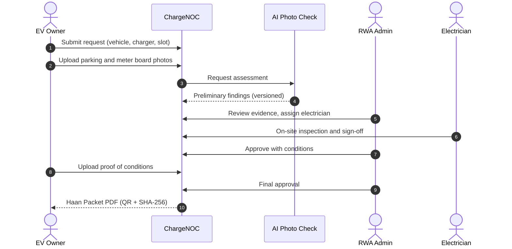

# ⚡ ChargeNOC

**From a 6-month society argument to a 7-day, evidence-backed, verifiable EV charging approval.**

ChargeNOC is a hardware-free platform that helps residents of Indian apartment societies request EV charging permission, and helps their Resident Welfare Association (RWA) decide using documented evidence instead of guesswork.

     

---

## Table of Contents

1. [The Problem](#the-problem)
2. [The Solution](#the-solution)
3. [How It Works](#how-it-works)
4. [Features](#features)
5. [Architecture](#architecture)
6. [Tech Stack](#tech-stack)
7. [Quick Start](#quick-start)
8. [Environment Variables](#environment-variables)
9. [Demo Accounts](#demo-accounts)
10. [Roles & Permissions](#roles--permissions)
11. [Haan Packet (NOC Dossier)](#haan-packet-noc-dossier)
12. [AI Integration Guide](#ai-integration-guide)
13. [Design Principles](#design-principles)
14. [Roadmap](#roadmap)
15. [Troubleshooting](#troubleshooting)
16. [License](#license)

---

## The Problem

More than 85% of EV charging in India happens at home, overnight. But in apartments and gated societies, residents need an RWA No Objection Certificate (NOC) before installing a charger, and that is where things stall:

- **Fear:** transformer overload, fire from poor wiring, water seepage in basements.
- **No standard process:** neither residents nor committees know the DISCOM and CEA rules.
- **Delay:** paper files and meeting-to-meeting deferrals turn one NOC into a **3 to 6 month** wait.
- **No evidence:** decisions rest on opinion, not proof.

## The Solution

ChargeNOC replaces opinion with an evidence pipeline:

> **Application → Photo evidence → AI preliminary screening → Electrician inspection → Conditional approval → Verified NOC (Haan Packet)**

The RWA can approve with **conditions** (for example, "install a 30 mA RCCB") rather than a blunt yes/no, and the final output is a tamper-evident document that society records and DISCOM meter applications can rely on.

## How It Works



## Features

| Area | What you get |
|------|--------------|
| **Landing page** | Interactive Three.js hero with a clear explanation of the process |
| **Authentication** | Email/password via Supabase Auth, JWT verified on the backend |
| **Role-based dashboards** | Separate, guarded experiences for owners, RWA admins, electricians and super admins |
| **Evidence capture** | Photo uploads to private Supabase Storage |
| **AI Photo Check** | Preliminary screening through a clean, swappable service interface (mock in Phase 1) |
| **Conditional approval** | Conditions with proof upload and verification |
| **Haan Packet** | Verifiable NOC PDF generated with ReportLab |
| **Auditability** | Append-only assessments, so history is never overwritten |

## Architecture

```
┌──────────────┐     REST + JWT      ┌─────────────────┐     ┌──────────────────┐
│  Frontend    │ ──────────────────▶ │  Backend        │ ──▶ │  Supabase        │
│  Next.js 15  │                     │  Django + DRF   │     │  Postgres, Auth, │
│  :3000       │ ◀────────────────── │  :8000          │ ◀── │  Storage         │
└──────────────┘                     └───────┬─────────┘     └──────────────────┘
                                             │
                          PhotoCheckService  │  ReportLab
                          (mock | http)      ▼
                                     ┌───────────────┐
                                     │ AI Photo Check│   Haan Packet PDF
                                     │ (separate svc)│
                                     └───────────────┘
```

**Monorepo layout**

| Directory | Stack | Purpose |
|-----------|-------|---------|
| `frontend/` | Next.js 15, TypeScript, Tailwind CSS | App Router SPA with role-based dashboards |
| `backend/` | Django 5, Django REST Framework | API server, business logic, PDF generation |
| `docs/` | Markdown | Architecture notes, API contracts, decision records |

## Tech Stack

- **Frontend:** Next.js 15 (App Router), TypeScript, Tailwind CSS, Three.js
- **Backend:** Django 5, Django REST Framework, Python 3.12+
- **Data & Auth:** Supabase (Postgres, Auth, Storage)
- **Documents:** ReportLab (pure Python, no system dependencies)
- **AI:** pluggable `PhotoCheckService` (mock now, HTTP service next)

## Quick Start

### Prerequisites

- **Node.js** >= 18
- **Python** 3.12+
- A **Supabase** project (the free tier is enough for development)

### 1. Install

```bash
# Frontend
cd frontend
npm install

# Backend
cd ../backend
python -m venv .venv

# Windows
.venv\Scripts\activate
# macOS / Linux
source .venv/bin/activate

pip install -r requirements.txt
```

### 2. Configure

```bash
cp frontend/.env.example frontend/.env.local
cp backend/.env.example backend/.env
```

Fill in the values (see [Environment Variables](#environment-variables)).

### 3. Set up the database

```bash
cd backend
python manage.py migrate
python manage.py seed_demo   # demo society, users and sample data
```

### 4. Run

```bash
# Terminal 1: backend
cd backend
python manage.py runserver

# Terminal 2: frontend
cd frontend
npm run dev
```

| Service | URL |
|---------|-----|
| Web app | http://localhost:3000 |
| API | http://localhost:8000/api/v1/ |

## Environment Variables

### Frontend (`frontend/.env.local`)

| Variable | Description |
|----------|-------------|
| `NEXT_PUBLIC_SUPABASE_URL` | Supabase project URL |
| `NEXT_PUBLIC_SUPABASE_ANON_KEY` | Supabase anonymous (public) key |
| `NEXT_PUBLIC_API_BASE_URL` | Backend API URL (default `http://localhost:8000`) |

### Backend (`backend/.env`)

| Variable | Description |
|----------|-------------|
| `DJANGO_SECRET_KEY` | Django secret key |
| `DJANGO_DEBUG` | `True` for development only |
| `DJANGO_ALLOWED_HOSTS` | Comma-separated allowed hosts |
| `DATABASE_URL` | Supabase Postgres connection string |
| `CORS_ALLOWED_ORIGINS` | Comma-separated CORS origins |
| `SUPABASE_URL` | Supabase project URL |
| `SUPABASE_SERVICE_ROLE_KEY` | Service role key (**server only**) |
| `SUPABASE_JWT_SECRET` | Secret for JWT verification |
| `SUPABASE_STORAGE_BUCKET` | Private storage bucket name |
| `PHOTO_CHECK_BACKEND` | `mock` or `http` |
| `DEMO_OWNER_PASSWORD` | Demo EV owner password |
| `DEMO_RWA_PASSWORD` | Demo RWA admin password |
| `DEMO_ELECTRICIAN_PASSWORD` | Demo electrician password |
| `DEMO_ADMIN_PASSWORD` | Demo super admin password |

> 🔐 **Security:** never commit `.env` files. The service role key and JWT secret must never reach the frontend.

## Demo Accounts

Available after `seed_demo`. Passwords come from the environment variables above.

| Role | Email |
|------|-------|
| EV Owner | `owner@chargenoc.demo` |
| RWA Admin | `rwa@chargenoc.demo` |
| Electrician | `electrician@chargenoc.demo` |
| Super Admin | `admin@chargenoc.demo` |

**Suggested demo walkthrough:** log in as the owner, open a request and upload photos, review the AI assessment, then switch to RWA admin and electrician views, and finish by downloading the Haan Packet.

## Roles & Permissions

| Role | Access |
|------|--------|
| `ev_owner` | Own requests, evidence, conditions, slots, bills, packets |
| `rwa_admin` | Society-scoped requests and decisions |
| `electrician` | Assigned inspections only |
| `super_admin` | Read-only overview of all data (Phase 1) |

Access is enforced on the backend per request, not just hidden in the UI.

## Haan Packet (NOC Dossier)

The Haan Packet is the final deliverable of an approved request, generated with ReportLab. It is designed to contain:

- Society NOC with a reference number
- Resident and request details
- Inspection sign-off and conditions
- A **SHA-256 verification hash** and **QR code** so the document's authenticity can be checked

## AI Integration Guide

The AI Photo Check service is built by a separate teammate. Phase 1 ships with a `MockPhotoCheckService` that returns deterministic demo assessments.

### Integration point

- **Backend:** `assessments/services.py` defines a `PhotoCheckService` protocol with an `assess(request_id)` method.
- **Selection:** set `PHOTO_CHECK_BACKEND=mock` or `PHOTO_CHECK_BACKEND=http`.
- **Contract:** see `docs/api-contract.md` for the full `Assessment` type.

### Key rules

1. AI output is **preliminary screening, not electrical certification**.
2. **Null confidence is never treated as high confidence.**
3. The UI **never auto-approves** based on AI confidence.
4. Every assessment is stored as a **new version** (append-only).

## Design Principles

- **Evidence over opinion:** every decision is backed by photos, inspection data or proof.
- **Human in the loop:** AI screens, a licensed electrician verifies, the RWA decides.
- **Conditions, not just rejections:** give the committee a path to "yes, if".
- **Hardware-free:** no smart chargers or on-site devices required.
- **Auditable by default:** history is appended, never overwritten.

## Roadmap

**Phase 1 (current)**

- [x] Landing page with Three.js hero
- [x] Email/password authentication (Supabase)
- [x] Role-based routing and guards
- [x] Full EV Owner dashboard
- [x] RWA Admin inbox (read-only)
- [x] Electrician inspections list (read-only)
- [x] Super Admin overview (read-only)
- [x] Mock AI Photo Check service
- [x] Haan Packet PDF generation

**Future phases**

- [ ] Real AI service (`PHOTO_CHECK_BACKEND=http`)
- [ ] RWA decision actions and electrician sign-off from the UI
- [ ] Scheduling
- [ ] Billing and payments
- [ ] DISCOM meter application integration
- [ ] Sub-meter IoT billing
- [ ] Multi-lingual assistant (Hindi, Tamil, Kannada, Marathi)

## Troubleshooting

| Problem | Fix |
|---------|-----|
| `CORS` errors in the browser | Add the frontend origin to `CORS_ALLOWED_ORIGINS` and restart the backend |
| `401 Unauthorized` from the API | Check `SUPABASE_JWT_SECRET` matches your Supabase project |
| Demo login fails | Re-run `seed_demo` and confirm the `DEMO_*_PASSWORD` values are set |
| Frontend cannot reach the API | Verify `NEXT_PUBLIC_API_BASE_URL` and that the backend is running on port 8000 |
| `pip install` fails | Confirm Python 3.12+ and that the virtual environment is activated |

## License

Proprietary. All rights reserved.
